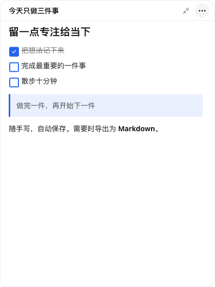
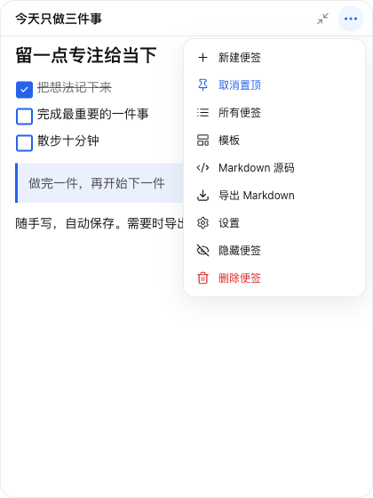

# PinNote

一张放在桌面上的 Markdown 便签。随手写，自动保存；暂时不用时，收成一颗小胶囊。

当前源码版本 **1.1.4**。对应安装包请以 GitHub Releases 中实际发布的版本为准。

## 界面

默认白底、黑字、蓝色强调。标题栏只保留标题、收起按钮和圆形菜单，低频操作集中在菜单里。




收起后的胶囊：


以上为真实前端使用测试内容的预览，不含个人便签。

## 使用

- **写字**：支持 Markdown 标题、列表、任务项、引用、代码和表格，内容自动保存。
- **收起 / 展开**：点击标题栏的向内收拢箭头，窗口缩为 `180 × 40` 胶囊；点击胶囊或按 Enter / 空格恢复。收起期间保留编辑器和撤销历史。
- **移动 / 缩放**：拖动标题栏空白处或胶囊移动；拖动展开窗口的边缘、四角缩放。展开模式最小 `260 × 180`，边角没有装饰性斜线。
- **圆形菜单**：新建、置顶、所有便签、模板、源码、导出、设置、隐藏和删除。菜单支持方向键、Escape 关闭及焦点返回。
- **多张便签**：每张是独立窗口，分别记住内容、外观、展开尺寸和胶囊位置。恢复位置时会限制在显示器工作区内，避免落到屏幕外或任务栏下。
- **托盘**：显示 / 隐藏全部便签、新建、设置、退出。关闭窗口会保存并隐藏；删除需要确认。
- **外观**：默认纯白，保留已有主题、自定义颜色和透明度。轻量过渡支持系统“减少动态效果”。

托盘和全局快捷键共用显示逻辑：只要有便签可见，就隐藏所有可见便签；全部隐藏时，恢复全部未删除的便签。重要记录可通过菜单导出 `.md` 文件。

## 快捷键

全局快捷键可在设置中修改；若被其他软件占用，便签会提示注册失败。

| 操作 | macOS 默认 | Windows 默认 |
| --- | --- | --- |
| 显示 / 隐藏全部便签 | Cmd + Option + N | Alt + N |
| 新建便签 | Cmd + Option + Shift + N | Alt + Shift + N |
| 导出当前便签 | Cmd + S | Ctrl + S |
| 切换置顶 | Cmd + T | Ctrl + T |
| 切换源码 | Cmd + / | Ctrl + / |
| 打开设置 | Cmd + , | Ctrl + , |
| 加粗 / 斜体 | Cmd + B / I | Ctrl + B / I |

后五项仅在便签聚焦时生效。源码与可视编辑使用各自的撤销历史，切换模式不共享撤销栈；收成胶囊不会切换编辑模式。

## 安装与平台状态

已发布安装包见 [Releases](https://github.com/Zhong0118/PinNote/releases)。请区分发布版本与当前源码版本。

- **macOS**：打开对应 `.dmg`，将应用复制到应用目录；本地构建也可直接运行 `.app`。当前开发版已在 Apple Silicon macOS 构建验证，并用隔离数据确认原生胶囊为 180 × 40、恢复坐标正确；使用本地临时签名，未做 Developer ID 签名与公证。
- **Windows**：在 Windows 上构建安装包并运行安装程序。界面、快捷键、托盘和自启使用同一套 Tauri 实现；macOS 专属行为有平台分支。本轮增加了 Windows CI 构建和测试配置，但尚未在真实 Windows 桌面验收，不能把模拟平台测试当作实机通过。

Windows 需要 WebView2；从源码构建还需要 Microsoft C++ Build Tools（桌面 C++ 工作负载）。macOS 构建需要 Xcode Command Line Tools。完整环境要求见 [Tauri 官方前置条件](https://v2.tauri.app/start/prerequisites/)。

## 检查更新

托盘右键菜单选择“检查更新”。发现新版后选择“更新并重启”，应用会下载并校验更新包，保存全部便签，再安装并自动重启。下载进度显示在同一个菜单项中，不增加常驻界面；选择“稍后”可继续使用当前版本。

正式构建在启动 10 秒后根据本地记录决定是否检查：距离上次检查满 24 小时才发起自动检查，否则等待剩余时间。检查时间会保存，关闭、重启应用不会重新计时；网络失败也计入检查间隔，避免离线时反复请求。手动检查可跳过 24 小时间隔，但距离上次检查至少需 30 秒；冷却期间菜单暂时显示“检查更新（稍后重试）”，到期自动恢复。手动检查也会刷新下一次自动检查时间。

同一版本只自动提醒一次，提醒记录跨重启保留。选择“稍后”后，可随时从托盘手动检查，再次选择安装。没有新版或后台检查时网络不可用不会弹窗；手动检查会明确反馈结果。下载或签名校验失败不会安装，保存失败或 15 秒内未收到所有便签的保存确认会取消安装并恢复编辑。

检查时间和已提醒版本保存在应用数据目录的 `update-history.json`，独立于便签和设置，使用原子写入。文件缺失或损坏时自动恢复；无法写入时仅保留本次运行的记录。系统时间回拨时允许重新检查并修正时间记录，避免长期无法更新。

支持 macOS Apple Silicon / Intel 和 Windows x64；Windows 沿用 NSIS / MSI 安装方式。Mac 应用请放在本机可写目录（如“应用程序”），不要直接从 DMG 中运行。Windows 安装可能需要系统权限确认。

**1.1.2 及更早版本没有更新入口，需要先手动安装 1.1.3 或更新版本一次。** 后续版本发布后即可在应用内更新。更新读取 GitHub Release 附件 `latest.json`（静态清单，不调用 Releases REST API），安装包也来自 GitHub，暂未接入 CDN，需能访问 GitHub；更新包签名用于验证来源，不等同于 Apple 公证或 Windows 代码签名。

## 开发与构建

技术栈：Tauri 2、Rust、Svelte 5 / SvelteKit、TypeScript、Milkdown、Lucide。沿用现有组件，没有新增 UI 依赖。

准备 Node.js 22+、pnpm 9、Rust stable 及对应平台工具链，然后运行：

```sh
pnpm install --frozen-lockfile
pnpm tauri dev
```

检查与测试：

```sh
pnpm check
pnpm test
pnpm build
cargo test --locked --manifest-path src-tauri/Cargo.toml
cargo clippy --locked --manifest-path src-tauri/Cargo.toml --all-targets -- -D warnings
```

在目标平台打包：

```sh
# 本地构建不生成更新签名；也可设置 TAURI_SIGNING_PRIVATE_KEY 后构建签名包
# macOS：构建 .app
pnpm tauri build --bundles app --config '{"bundle":{"createUpdaterArtifacts":false}}' -- --locked

# macOS：构建可上传 Release 的 .dmg 安装包
pnpm tauri build --bundles dmg --config '{"bundle":{"createUpdaterArtifacts":false}}' -- --locked

# Windows PowerShell：构建本机安装包（关闭更新产物，避免需要发布私钥）
pnpm tauri build --config '{"bundle":{"createUpdaterArtifacts":false}}' -- --locked
```

构建产物位于 `src-tauri/target/release/bundle/`。macOS 构建默认使用 ad-hoc 签名（仍未 Apple 公证），可检查签名完整性：

```sh
codesign --verify --deep --strict src-tauri/target/release/bundle/macos/PinNote.app
```

`.github/workflows/check.yml` 为 push / PR 配置 macOS、Windows 编译、类型检查和测试，不发布安装包；`release.yml` 保留 `v*` 标签触发的发布流程。推送普通分支不会创建 Release；推送 `v1.1.3` 等版本标签后，工作流会在 Windows 和 macOS runner 上打包并上传到对应 Release。macOS CI 构建通用包，支持 Apple Silicon 与 Intel；本机默认构建只包含当前架构。

发布流程先创建草稿 Release，生成安装包、`.sig` 签名和 `latest.json`。两个平台都成功、更新清单包含 Mac 双架构和 Windows NSIS / MSI 且对应附件齐备后，才公开发布。失败时草稿不会成为客户端的最新版本；修复后重跑失败的工作流即可。

仓库 Actions 必须配置 `TAURI_SIGNING_PRIVATE_KEY`；如私钥加密，还需 `TAURI_SIGNING_PRIVATE_KEY_PASSWORD`。公钥位于 `src-tauri/tauri.conf.json`。私钥应保存在仓库外并另行备份，不能提交到 Git，也不能在后续发布中随意更换，否则已安装客户端无法验证更新。普通 PR 检查不需要私钥。


Windows 安装包推荐交给上述 GitHub Actions 生成，无需本地 Windows 电脑。Mac 也能使用 NSIS、LLVM 和 `cargo-xwin` 交叉构建 Windows `.exe`，但配置更复杂；`.msi` 必须在 Windows 上构建。详见 [Tauri Windows 打包文档](https://v2.tauri.app/distribute/windows-installer/#build-windows-apps-on-linux-and-macos)。

## 数据与可靠性

数据保存在系统应用数据目录，通过“设置 → 行为 → 用户数据”可打开目录或复制路径。

| 文件 | 内容 |
| --- | --- |
| `notes.json` | 所有便签正文、外观和窗口状态 |
| `settings.json` | 快捷键与全局设置 |
| `templates.json` | 自定义模板，最多 8 个 |
| `update-history.json` | 上次更新检查时间与已提醒的版本 |

应用标识继续使用 `com.pinnote.app`，可读取旧数据；旧版单便签 `note.json` 自动迁移。备份时先从托盘退出，再复制整个数据目录。

保存失败会显示错误并保留草稿；隐藏或退出前会等待写入，退出保存失败会取消退出。损坏的便签文件会保留原文件并报告错误，不会当作空数据覆盖。修改外观不覆盖未保存的正文，多窗口按便签合并保存。

移动和缩放事件按 150 毫秒合并，正文按 500 毫秒合并写入。胶囊的尺寸不会覆盖展开尺寸；macOS 位置统一使用全局逻辑坐标，Windows 保留全局物理坐标，窗口大小使用逻辑像素。选屏按窗口覆盖面积，展开时保持右上锚点，超出目标屏幕工作区时向内收回。旧文件会在保存时迁移；旧胶囊未记录 DPI，首次迁移按当前窗口缩放换算。

## 回归验证

- `tests/notesStore.test.mjs`：保存失败重试、草稿快照、损坏数据和并发删除。
- `tests/windowGeometry.test.mjs`：胶囊往返、负坐标、多屏缩放、断开显示器和工作区边界。
- `tests/platform.test.mjs`：Windows / macOS 默认快捷键、并发注册与销毁、长按去重、部分注册失败、Option / 死键和空格录制。
- `tests/windowVisibility.test.mjs`：显隐确认、启动期请求重试、去重、串行执行、失败及过期请求。
- `tests/quitGuard.test.mjs`：晚创建窗口、过期保存回复与取消顺序。
- `tests/updateManifest.test.mjs`：完整发布清单及缺少平台、错误版本、签名不一致、附件缺失时阻止发布。
- Rust 单元测试：并发原子写入、退出/更新保存确认、超时取消、并发检查、跨重启的 24 小时检查间隔和 30 秒冷却、提醒去重、时钟回拨以及记录损坏／写入失败恢复。
- `src-tauri/tests/updater_contract.rs`：本地 HTTP 服务和独立测试签名验证旧版本忽略、损坏包拒绝、有效包下载；macOS 在临时目录验证应用替换，不接触个人应用或数据。
- 1.1.4 本地验证：61 项 Node 测试、16 项 Rust 单元测试和 1 项更新器集成测试通过，类型检查与 clippy 通过；macOS 正式构建及签名校验通过，实际退出重启后检查记录保持不变、未重复触发启动检查。本轮未进行 Windows 实机验收。
- 1.1.3 前端回归：61 项 Node 测试与 37 项浏览器检查通过，Svelte 类型检查无错误或警告。
- 1.1.2 回归基线：51 项 Node 测试、4 项 Rust 测试、34 项浏览器检查通过，类型检查与 Rust clippy 通过；浏览器场景另以 Windows 平台模拟运行通过。
- macOS 隔离应用实测：双屏往返移动、跨屏边界选屏、屏幕边缘展开和托盘事件显隐通过。逐帧采样确认页面随原生窗口连续展开，顶部和右边缘固定。当前两块实测屏幕均为 2× 缩放；混合 DPI 与断屏恢复另有模拟测试。
- `tests/browser-regression.mjs`：真实 Svelte / Milkdown 页面配合模拟 Tauri IPC，验证编辑、保存、菜单和胶囊交互，不读取个人便签。

浏览器场景是接受 Playwright `page` 的异步函数。先运行 `pnpm dev --host 127.0.0.1`，再用 Playwright MCP 的代码执行工具运行该文件内容。它不替代真实系统窗口测试。

发布前仍需在 Windows 实机检查安装、托盘、快捷键冲突、自启和胶囊拖动，并在真实混合 DPI 多屏环境验证拔插显示器。基础图片引用可用，但暂不提供本地图片导入或资源管理。

## 1.1.4 更新检查记录

- 检查时间和已提醒版本保存到本地，重启后仍遵守 24 小时自动检查间隔，同一版本不再重复自动提醒。
- 手动检查增加 30 秒冷却，沿用托盘菜单反馈，不增加常驻界面。
- 保留 GitHub Release 静态更新清单与签名校验，不引入 CDN 或新依赖。

## 1.1.3 应用内更新

- 托盘增加“检查更新”，支持 Mac / Windows 下载、签名校验、保存便签、安装及重启。
- 后台仅在有新版本时提醒，下载进度复用菜单项。
- 安装前等待所有便签保存；保存失败、超时或安装失败会恢复编辑，晚创建的便签也受保护。
- GitHub Actions 自动生成签名与更新清单，完整构建后再公开 Release。

## 1.1.2 托盘、多屏与动画修复

- 修复 macOS 展开时先左移、页面最后才变大的问题：使用非阻塞原生动画，让 WebView 随窗口逐帧重绘。
- 胶囊跨屏后按主要覆盖区域决定展开屏幕；统一 macOS 跨 DPI 坐标，恢复被拔掉的屏幕上的隐藏窗口时重新限制位置。
- 连续托盘操作等待实际保存和显隐结果；新窗口启动期间重试请求，过期请求不再延迟隐藏便签。
- 快捷键注册与注销串行执行，旧回调立即失效，长按只触发一次。
- 保持 1.1.1 的极简界面布局。

## 1.1.1 外观与动画

- 正文首行与标题栏的间距从约 26 像素缩到 8 像素，标题与正文统一左侧对齐，调整标题字号和字重。
- 收起按钮改为向内箭头，与胶囊的展开图标成对。
- macOS 使用系统原生窗口动画同步位置与尺寸，正文先淡出、展开后再淡入，避免直接跳变和缩放中的文字重排。
- 系统开启“减少动态效果”时跳过原生动画。Windows 保留通用窗口调整路径与界面淡入淡出。
- 当时的采样只验证了原生窗口边框，未覆盖页面重绘延迟；该问题在 1.1.2 中补测并修复。

## 1.1.0 改动

- 工具栏收为圆形菜单，统一默认白色界面，增加按钮反馈与轻量过渡。
- 新增真正缩小原生窗口的胶囊模式，保留编辑尺寸、位置和当前编辑历史。
- 移除右下角斜线，保留边缘和四角缩放。
- 修复保存队列重试、模式切换丢字、外观同步覆盖正文、退出与删除的竞态问题。
- 补齐位置恢复、工作区约束、快捷键录制和跨平台构建检查；修复 macOS 调整高度时上边缘跳动。
- 重写 README，移除过期 Roadmap。后续优先完成桌面实机验收，继续保持极简便签定位。

## License

MIT
