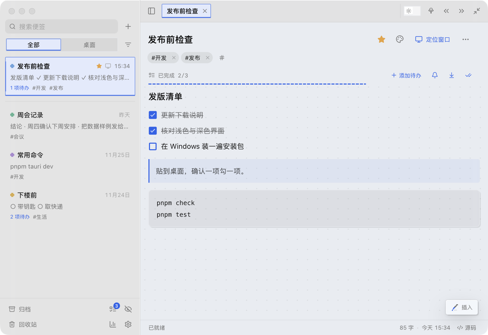

<p align="center">
  
</p>

<h1 align="center">InkPin</h1>

<p align="center">macOS 和 Windows 上的本地 Markdown 便签。把正在用的便签贴在桌面，腾位置时就收到屏幕边缘。</p>
<p align="center">
  <a href="https://github.com/Zhong0118/PinNote/releases/latest"><strong>下载安装</strong></a> ·
  <a href="https://zhong0118.github.io/PinNote/guide/">使用指南</a> ·
  <a href="RELEASE_NOTES.md">更新记录</a> ·
  <a href="https://zhong0118.github.io/PinNote/">产品站</a>
</p>

> 下文和截图展示 1.4.0。安装包的版本以 [Releases](https://github.com/Zhong0118/PinNote/releases/latest) 为准。

<picture>
  <source media="(prefers-color-scheme: dark)" srcset="assets/readme/center-dark.png" />
  
</picture>

<sub>macOS 原生窗口截图，使用示例便签。图片随 GitHub 的明暗主题切换。</sub>

## 从速记到贴边

1. 按 **⌘⌥Space**，或在 Windows 按 **Alt+Shift+Space**，打开速记。输入下面这行，会识别成一个待办、一个标签和一条 30 分钟后的提醒。

   ```text
   [] 检查安装包 #发布 @30m
   ```

2. 默认按 **Enter** 存进中心。按 **⌘Enter** 或 **Ctrl+Enter** 直接放到桌面。桌面便签可以置顶，也能切到「穿透参考模式」，继续操作下面的窗口。
3. 把便签拖到屏幕侧边，或收成一条胶囊。悬停就能看摘要、勾待办、复制代码。点一下展开，继续编辑同一张便签。

提醒需要系统通知权限和正在运行的应用。

## 便签中心

- 用 **⌘K / Ctrl+K** 找便签或执行命令。标签、收藏和筛选用来整理，归档和回收站用来收起暂时用不到的内容。
- 在正文里混排待办、代码和图片，用右下角「插入」菜单快速添加。可切到 Markdown 源码，也可以把 `.md` 或 `.txt` 文件拖进中心。
- 底部「待办汇总」可以勾选分散在不同便签里的任务。记录概览显示本机编辑记录和待办进度。
- 外观用方形控件、蓝色选中边框和像素进度条。点阵纸纹可以关闭。macOS 可调毛玻璃透明度，支持浅色、深色和系统的减少动态及降低透明度设置。

## 下载

| 平台 | 安装包 |
| --- | --- |
| macOS · Apple Silicon / Intel | 通用 `.dmg`，打开后拖入「应用程序」 |
| Windows · x64 | `.exe` 或 `.msi`，需要 WebView2 |

macOS 也可通过 Homebrew 安装发布版：

```sh
brew install --cask zhong0118/tap/pinnote
```

通过 Homebrew 装过旧版时，先运行 `brew update`，再运行 `brew upgrade --cask --greedy zhong0118/tap/pinnote`。升级后应用名为 InkPin，便签仍使用原来的数据目录。若 Homebrew 要求先信任配方，运行 `brew trust --cask zhong0118/tap/pinnote`。

macOS 安装包使用 ad-hoc 签名，尚未通过 Apple 公证。应用内的「检查更新」可以从托盘打开。

## 数据与导出

便签存放在本机。在「设置 → 数据与更新」可打开数据目录、恢复备份，或导出 Markdown。导出时会一起复制便签引用的本地图片。应用每天检查内容是否有改动，保留最近 14 份自动备份。单张便签也能在「历史版本」里恢复较早的内容。

[本地 MCP](docs/usage.md#本地-mcp) 可让客户端搜索和读取便签。功能默认关闭，启用后可单独授权写入。

## 本地开发

使用 Tauri 2、Rust、SvelteKit 和 Milkdown。需要 Node.js 22+、pnpm 9、Rust stable 和 [Tauri 平台前置环境](https://v2.tauri.app/start/prerequisites/)。

```sh
git clone https://github.com/Zhong0118/PinNote.git
cd PinNote
pnpm install --frozen-lockfile
pnpm tauri dev
```

<details>
<summary>检查与打包</summary>

```sh
pnpm check
pnpm test
pnpm build
cargo test --manifest-path src-tauri/Cargo.toml --locked
cargo clippy --manifest-path src-tauri/Cargo.toml --locked --all-targets -- -D warnings
pnpm tauri build --config '{"bundle":{"createUpdaterArtifacts":false}}' -- --locked
```

打包产物位于 `src-tauri/target/release/bundle/`。发布工作流会先校验各平台安装包和更新签名。原生窗口验收和已知限制见 [开发记录](DEVELOPMENT.md)。

</details>

MIT · [报告问题](https://github.com/Zhong0118/PinNote/issues)
