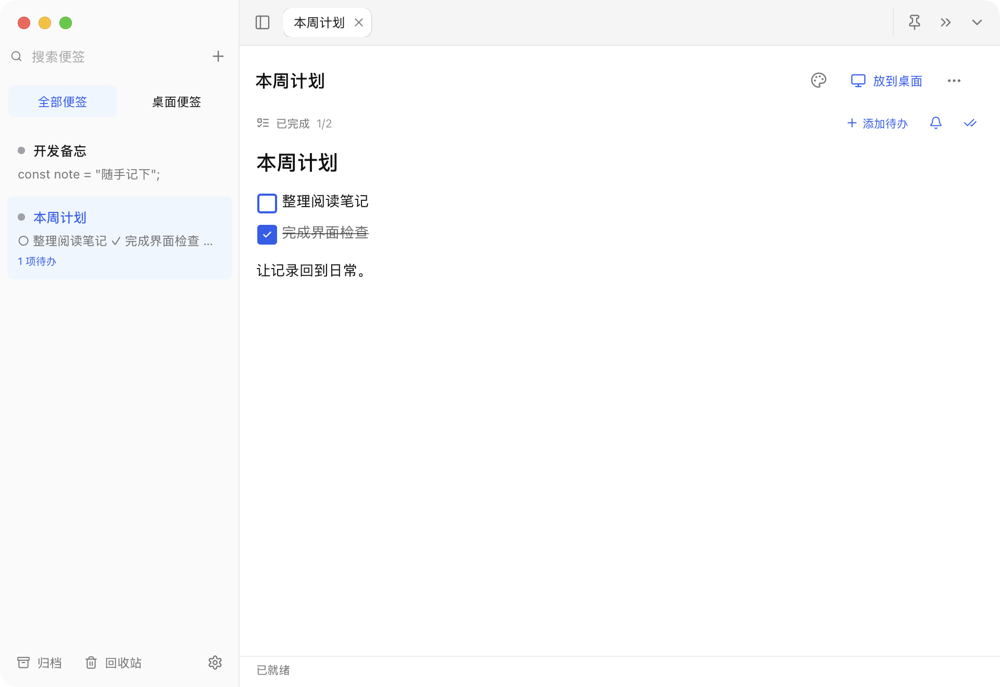
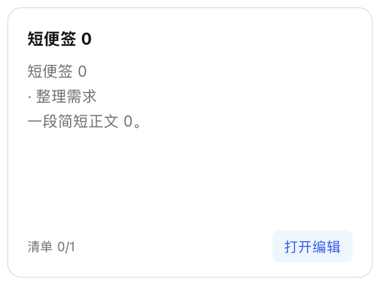
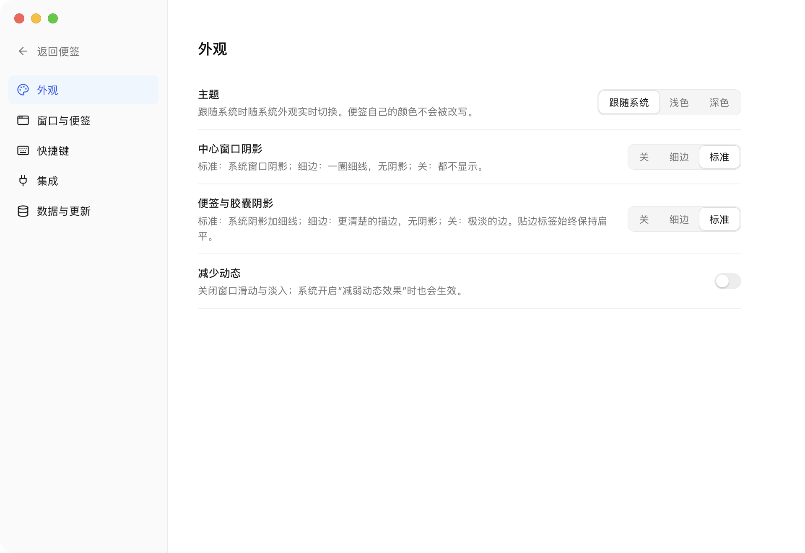

<h1 align="center">PinNote</h1>

<p align="center">随手写下，收在屏幕边缘，需要时再展开</p>
<p align="center">macOS 与 Windows 上的轻量 Markdown 桌面便签</p>
<p align="center">
  <a href="https://github.com/Zhong0118/PinNote/releases/latest"><strong>下载安装</strong></a> ·
  <a href="docs/usage.md">使用手册</a> ·
  <a href="docs/usage.md#本地-mcp">连接 AI 工具</a> ·
  <a href="RELEASE_NOTES.md">更新</a>
</p>

<picture>
  <source media="(prefers-color-scheme: dark)" srcset="assets/readme/center-dark.png" />
  
</picture>

<p align="center"><sub>真实 macOS 应用截图 · 浅色 / 深色跟随页面主题</sub></p>

## 同一张便签，三种打开方式

在中心整理，把正在用的便签放到桌面，暂时不用时收成胶囊或贴边标签。内容自动保存，切换形态继续写。

| 形态 | 适合什么时候 |
| --- | --- |
| **便签中心** | 搜索、切换标签、集中整理与归档 |
| **桌面便签** | 独立窗口置顶，把正在用的内容放在手边 |
| **胶囊与贴边标签** | 暂时收起，悬停看摘要，需要时点击展开 |

<p>
  
</p>

<details>
<summary>看看悬停预览与外观设置</summary>

<p>不展开也能先看摘要和待办进度</p>


<p>浅色、深色、跟随系统，也可以减少动态</p>


<p><sub>中心与设置截图来自 2026-11-09 的源码调试构建，使用隔离示例数据。胶囊与预览沿用 1.3.1 原生截图。</sub></p>

</details>

## 下载与开始使用

从 [最新 Release](https://github.com/Zhong0118/PinNote/releases/latest) 下载安装包：

| 平台 | 安装包 | 安装方式 |
| --- | --- | --- |
| macOS · Apple Silicon / Intel | Universal `.dmg` | 打开后拖入「应用程序」 |
| Windows · x64 | `.exe` / `.msi` | 运行安装程序，需要 WebView2 |

macOS 安装包使用 ad-hoc 签名，尚未做 Developer ID 签名与 Apple 公证。当前源码版本为 **1.3.7**；安装包的版本以 Release 页面为准。

1. **写下来** — 打开便签中心，点击「新建便签」，直接输入文字、Markdown 或待办清单。
2. **放到手边** — 点击「放到桌面」，按需置顶；收起为胶囊，或拖到屏幕左右边缘收纳。
3. **随时找回** — 从托盘打开便签中心，按标题和正文搜索；用完的便签归档，误删的从回收站恢复。

**更新在托盘里。**「检查更新」会下载新版并校验签名，先保存便签再安装重启。应用每 24 小时自动检查一次，同一版本只提醒一次。需要能访问 GitHub；1.1.2 及更早版本请先手动安装新版。

## 能做什么

| 能力 | 可以做什么 |
| --- | --- |
| **Markdown 编辑** | 标题、列表、引用、代码、表格与源码模式，支持导出 `.md` |
| **便签中心** | 搜索标题、正文和标签并高亮命中词，多张便签以标签页打开；列表显示编辑时间，可拖动排序、调整宽度 |
| **收藏、标签与筛选** | 收藏的便签固定在列表顶部；标题下方加标签；按收藏、有提醒、有未完成待办或标签快速筛选 |
| **正文清单** | 在文字之间插入勾选项，查看完成进度，一次清理已完成项并可撤销 |
| **一次性提醒** | 每张便签设置一个提醒时间，到点系统通知，也可以延后 |
| **外观与窗口** | 浅色 / 深色 / 跟随系统，自定义便签颜色、置顶、阴影与减少动态；可在共享屏幕时隐藏窗口 |
| **归档与恢复** | 归档、回收站（默认 30 天后自动清空，可改为 60、90 天或永不）和可恢复历史；每张便签保留最近 20 个历史版本，可以换回 |
| **备份与导出** | 每天自动备份全部便签并保留 14 份，可在设置里一键恢复；一键把全部便签导出为 Markdown 文件 |
| **记录概览** | 便签数、近 7 天编辑、本月完成的待办、连续记录天数和半年热力图，只在本机统计 |
| **本地 MCP** | 让 AI 工具搜索、读写和整理便签；默认关闭，启用后默认只读 |

[查看全部操作与快捷键](docs/usage.md#快捷键) · [配置 MCP 客户端](docs/usage.md#本地-mcp)

## 它是便签，不是任务管理器

PinNote 用来放手边马上要用的东西：一段文字、一张清单、一条临时信息，用完归档。为了保持轻巧，下面这些有意不做：

- **没有独立的待办系统**：清单写在便签正文里，可以勾选、看进度，但没有逐项截止日期、重复任务、“今天”视图或项目分组。
- **提醒按便签设置**：每张便签一个一次性提醒。某件事需要单独提醒时，把它写成单独的一张便签。提醒需要应用在运行，完全退出后不会通知。
- **不做知识库**：没有文件夹、嵌套分类或双向链接。标签只是标题下的轻量标记，配合收藏、搜索和归档就够整理。
- **不做云同步**：便签只存在本机，不同电脑之间不会自动同步。

## 数据留在本机

便签保存在本地应用数据目录，可从「设置 → 数据与更新 → 数据目录」打开。PinNote 每天自动备份一次全部便签，保留最近 14 份，可以在「设置 → 数据与更新」里恢复；恢复前会先把当前内容另存一份。也可以「导出全部」，得到一个装满 Markdown 文件的文件夹。手动备份时先从托盘退出，再复制整个目录；降级前也请先备份。

中心与桌面共享同一张便签，同一时间由一个位置编辑；移交前先保存草稿。保存失败会保留待保存修改并提示错误，损坏文件不会当作空库覆盖。

提醒还需要系统通知权限。Windows 原生交互、混合 DPI 多屏和系统窗口平铺下的贴边操作仍需更多实机验收。[数据文件与兼容说明](docs/usage.md#数据与兼容) · [验证记录](DEVELOPMENT.md)

## 本地开发

使用 Tauri 2、Rust、Svelte 5 / SvelteKit、TypeScript、Milkdown 与 Lucide。

准备 Node.js 22+、pnpm 9、Rust stable 和 [Tauri 平台前置环境](https://v2.tauri.app/start/prerequisites/)：

```sh
git clone https://github.com/Zhong0118/PinNote.git
cd PinNote
pnpm install --frozen-lockfile
pnpm tauri dev
```

<details>
<summary>检查与打包命令</summary>

```sh
pnpm check
pnpm test
pnpm tauri build --no-bundle --ci -- --locked
cargo test --manifest-path src-tauri/Cargo.toml --locked
cargo clippy --manifest-path src-tauri/Cargo.toml --locked --all-targets -- -D warnings
```

本地打包，不生成更新签名：

```sh
pnpm tauri build --config '{"bundle":{"createUpdaterArtifacts":false}}' -- --locked
```

产物位于 `src-tauri/target/release/bundle/`。推送 `v*` 标签触发 Mac 与 Windows 发布工作流，安装包、更新签名和清单完整校验后才公开 Release。发布使用已有更新签名密钥，不能随意更换，否则旧客户端无法验签；更新签名不等同于系统代码签名或 Apple 公证。

浏览器与原生验收、性能脚本和已知限制见 [DEVELOPMENT.md](DEVELOPMENT.md)。

</details>

---

MIT · [使用手册](docs/usage.md) · [更新说明](RELEASE_NOTES.md) · [报告问题](https://github.com/Zhong0118/PinNote/issues)
